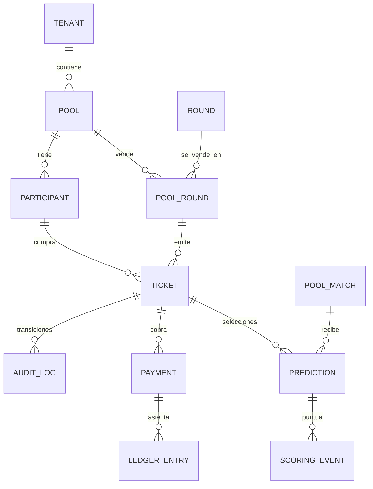
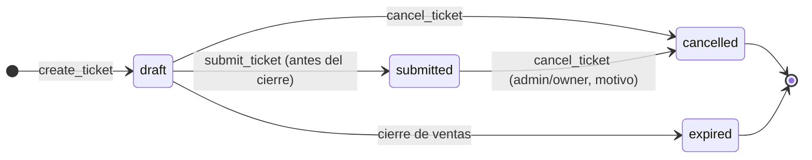
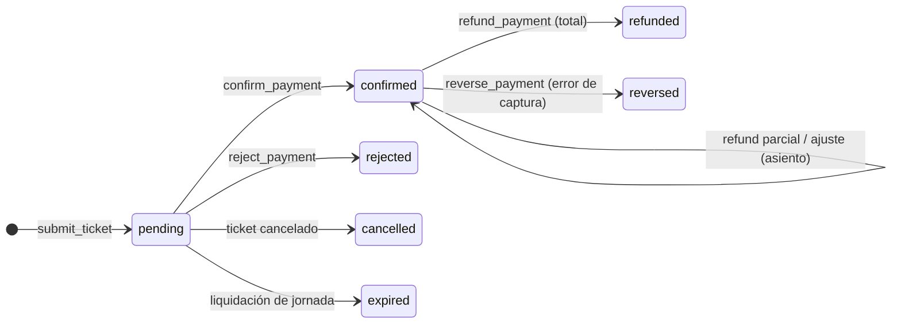

# ADR-014 — Anexo técnico: tickets, pagos manuales y ledger

Estado: **Proposed** (acompaña a [ADR-014](adr/ADR-014-multi-tenant-tickets-payments-and-ledger.md)).

> **Revisión 2 (2026-10-11):** este anexo es la versión 1. Donde difiera de ADR-014 o de [`ADR-014-REVIEW-20261011.md`](ADR-014-REVIEW-20261011.md) **prevalecen estos últimos**. Cambios que lo afectan: `pool_staff` reemplaza a `is_tenant_admin` en §4/§6; `tickets.eligibility` + sello sustituyen la elegibilidad por pago en vivo (§2, §7, D6); numeración gap-tolerant (§1, §9); `pools.currency`; UNIQUE y FK de reemplazo (P4/P5); congelación de `pool_rounds`; el plan de §10 lo reemplaza revisión §6; benchmarks en revisión §7; las decisiones de §12 las reemplaza ADR-014 «Decisiones de producto»; la autoconfirmación (T13, D7/D14) queda resuelta por ADR-015.
DDL conceptual: ilustra restricciones e invariantes; no es una migración ni se ejecuta. Convenciones de
Fase 03: FK compuestas `(id, tenant_id…)`, RPC `SECURITY DEFINER`, `search_path = public, auth`, importes
en unidades mínimas (`bigint`), tiempo con la hora de PostgreSQL.

## 1. Modelo de datos propuesto

| Tabla | Cambio | Propósito |
| --- | --- | --- |
| `pools` | `+ ticketing_mode` (`none` \| `tickets`, default `none`) | Activa tickets por quiniela sin alterar las existentes. |
| `pool_matches` | `+ round_id` (derivado de `matches`; FK `(match_id, round_id, tenant_id)` → `matches`, que requiere `unique (id, round_id, tenant_id)`) | Permite FK compuesta ticket↔partido de la misma jornada. |
| `pool_rounds` | nueva | Jornada vendible de una quiniela y su configuración comercial. |
| `tickets` | nueva | La jugada: pertenece a tenant, pool, jornada y participante. |
| `predictions` | `+ ticket_id`, `+ round_id` (nullable) | Selecciones del ticket; índices únicos parciales. |
| `payments` | nueva (fase comercial) | Obligación/cobro de un ticket; estado propio. |
| `ledger_entries` | nueva (fase comercial) | Hechos financieros inmutables (única fuente de ingresos). |
| `idempotency_keys` | nueva | Respuesta guardada por `(actor, operación, clave)`. |
| `audit_log` | sin cambio de forma; endurecer inmutabilidad (D12) | Acciones administrativas y transiciones. |

```sql
-- pool_rounds: una fila por (pool, jornada). Precio y cupo viven aquí, nunca en el cliente.
pool_rounds(
  id uuid pk, tenant_id uuid not null, pool_id uuid not null, round_id uuid not null,
  sales_status text check (in ('draft','open','closed','settled')) default 'draft',
  ticket_price_minor bigint not null check (>= 0), currency char(3) not null check (~ '^[A-Z]{3}$'),
  max_tickets_per_participant int not null default 1 check (between 1 and 100),
  sales_closes_at timestamptz null,        -- opcional; el efectivo = least(esto, primer lock_at de la jornada)
  ticket_seq bigint not null default 0,    -- contador de ticket_no (fila caliente por pool-jornada)
  created_at, updated_at,
  unique (id, tenant_id), unique (pool_id, round_id), unique (id, tenant_id, pool_id, round_id),
  foreign key (pool_id, tenant_id)  references pools(id, tenant_id)  on delete restrict,
  foreign key (round_id, tenant_id) references rounds(id, tenant_id) on delete restrict )

tickets(
  id uuid pk, tenant_id uuid not null, pool_id uuid not null, round_id uuid not null,
  participant_id uuid not null, profile_id uuid not null,       -- profile_id denormalizado para RLS/perf
  ticket_no bigint not null, public_code text not null,          -- 12 chars aleatorios (no enumerables)
  status text not null check (in ('draft','submitted','cancelled','expired')) default 'draft',
  price_minor bigint not null, currency char(3) not null,        -- snapshot server-side de pool_rounds
  version int not null default 1,                                -- concurrencia optimista
  submitted_at timestamptz, cancelled_at timestamptz, cancel_reason text,
  created_at, updated_at,
  unique (id, tenant_id), unique (id, tenant_id, pool_id, round_id),
  unique (pool_id, round_id, ticket_no), unique (public_code),
  foreign key (pool_id, round_id, tenant_id) references pool_rounds(pool_id, round_id, tenant_id) on delete restrict,
  foreign key (participant_id, tenant_id, pool_id, profile_id)
      references participants(id, tenant_id, pool_id, profile_id) on delete restrict ) -- +unique aditivo en participants

predictions( ... + ticket_id uuid null, + round_id uuid null,
  foreign key (ticket_id, tenant_id, pool_id, round_id) references tickets(id, tenant_id, pool_id, round_id) on delete restrict,
  foreign key (pool_match_id, tenant_id, pool_id, round_id) references pool_matches(id, tenant_id, pool_id, round_id),
  check ((ticket_id is null) = (round_id is null)) )
-- reemplaza unique(participant_id,pool_match_id) por:
--   unique (ticket_id, pool_match_id)            where ticket_id is not null
--   unique (participant_id, pool_match_id)       where ticket_id is null

payments(
  id uuid pk, tenant_id, pool_id, round_id, ticket_id uuid not null,
  amount_minor bigint not null check (>= 0), currency char(3) not null,   -- copia del ticket, no del cliente
  method text check (in ('manual_cash','manual_transfer','manual_other','gateway')),
  status text check (in ('pending','confirmed','rejected','cancelled','expired','refunded','reversed')),
  provider text null, provider_ref text null check (char_length(provider_ref) <= 64),
  confirmed_by uuid null, confirmed_at timestamptz null, version int default 1, created_at, updated_at,
  foreign key (ticket_id, tenant_id, pool_id, round_id) references tickets(...) on delete restrict )
-- unique (ticket_id) where status in ('pending','confirmed')       -> un pago activo por ticket
-- unique (tenant_id, provider, provider_ref) where provider_ref is not null  -> misma referencia no se usa dos veces

ledger_entries(
  id uuid pk, tenant_id, pool_id, round_id, ticket_id, payment_id uuid not null,
  kind text check (in ('payment_confirmed','payment_reversed','refund','adjustment')),
  amount_minor bigint not null,    -- con signo; check por kind: confirmed >0, reversed/refund <0, adjustment <> 0
  currency char(3) not null, occurred_at timestamptz not null default clock_timestamp(),
  actor_id uuid not null, reason text null, reverses_entry_id uuid null, operation_key text not null,
  foreign key (payment_id, tenant_id) references payments(id, tenant_id) on delete restrict )
-- unique (payment_id) where kind='payment_confirmed'   -> imposible contar dos veces un cobro
-- unique (reverses_entry_id) where reverses_entry_id is not null
-- unique (tenant_id, operation_key)                    -> misma operación no repite asiento
-- trigger BEFORE UPDATE/DELETE -> raise; revoke update, delete, truncate

idempotency_keys(
  actor_id uuid, operation text, key uuid, request_hash bytea not null,
  result_ref uuid null, response jsonb null, created_at, expires_at,
  primary key (actor_id, operation, key) )   -- retención 30 días; el ledger no depende de esta tabla
```

Precio gratis: `ticket_price_minor = 0` crea un pago `confirmed` con `amount_minor = 0` **sin** asiento
de ledger (el check de `kind` exige importe ≠ 0). Elegibilidad = `submitted` ∧ pago `confirmed`.

### Diagrama de relaciones



Toda arista incluye `tenant_id` en la FK compuesta; un ticket no puede apuntar a un pool de otro tenant ni
a una jornada que el pool no vende, ni a un `pool_match` de otra jornada.

## 2. Estados y transiciones

Tres máquinas independientes; ninguna columna de una contiene el estado de otra.





| Transición | Quién | Precondiciones (servidor) |
| --- | --- | --- |
| `draft→submitted` | dueño | sesión; participante `approved`; `pool_round.sales_status='open'`; `clock_timestamp() < cierre efectivo`; ticket completo (una selección por `pool_match` de la jornada); crea `payment(pending)` o `confirmed` si precio 0 |
| `draft→cancelled` | dueño o admin | ticket sin pago confirmado |
| `submitted→cancelled` | dueño (antes del cierre y con pago no confirmado) o admin/owner con motivo | si el pago está `confirmed`, la cancelación exige `refund` en la misma transacción (solo owner) |
| `pending→confirmed` | admin/owner | pago `pending`; importe = snapshot; no es el propio ticket del actor (D7) |
| `confirmed→refunded/reversed` | solo owner | motivo obligatorio; asiento negativo; suma de asientos del pago ≥ 0 |

El **estado de los pronósticos** no es una columna: cada `prediction` está abierta/bloqueada según su
`lock_at` (ADR-011) y puntuada según `scoring_events` (ADR-012). Un ticket `submitted` congela sus
selecciones (sin edición); el borrador solo permite editar selecciones cuyo partido siga abierto.

## 3. Diseño de RPC transaccionales

Todas: `SECURITY DEFINER`, `search_path = public, auth`, `REVOKE ALL FROM public, anon; GRANT EXECUTE TO authenticated`,
validan `auth.uid() IS NOT NULL` (`28000`), derivan tenant del pool/ticket (nunca de un parámetro), devuelven
errores con `errcode` estables (`42501` autorización, `22023` validación, `40001`/`23505` conflicto/duplicado,
`P0001` regla de negocio) y mensajes sin PII.

| RPC | Entrada (solo localizadores) | Resultado | Notas |
| --- | --- | --- | --- |
| `create_ticket(p_pool_id, p_round_id, p_key)` | ids + clave | ticket `draft` | bloquea `participants` (FOR UPDATE), cuenta tickets no cancelados/expirados vs `max_tickets_per_participant`, incrementa `ticket_seq`, copia precio |
| `save_ticket_selections(p_ticket_id, p_expected_version, p_selections jsonb)` | selecciones `{pool_match_id, home, away}` ≤ 64 | ticket + `lock_at` por selección | solo `draft` del dueño; rechaza selección con `clock_timestamp() >= lock_at`; versión optimista; UPSERT por `(ticket_id, pool_match_id)` |
| `submit_ticket(p_ticket_id, p_key)` | id + clave | ticket + pago | valida completitud y cierre; congela; crea pago |
| `cancel_ticket(p_ticket_id, p_reason, p_key)` | id + motivo | ticket | ver tabla de transiciones |
| `confirm_payment(p_payment_id, p_method, p_reference, p_key)` | **sin importe** | pago | `FOR UPDATE` del pago; si ya `confirmed` devuelve el mismo resultado (idempotente); inserta asiento `payment_confirmed` con el importe del snapshot |
| `reject_payment(p_payment_id, p_reason, p_key)` | | pago | solo `pending` |
| `refund_payment(p_payment_id, p_amount_minor, p_reason, p_key)` | importe del reembolso | asiento negativo | solo owner; `Σ asientos del pago − importe ≥ 0`; el importe es un *límite* validado, no un total; excede → error |
| `reverse_payment(p_payment_id, p_reason, p_key)` | | reverso | corrige confirmación errónea; deja el pago `reversed`, libera el pago activo del ticket |
| `list_pool_tickets(p_pool_id, p_round_id, p_status, p_after_created_at, p_after_id, p_limit)` | filtros + cursor | ≤ 100 filas | solo admin; sin selecciones previas al lock |
| `list_my_tickets(p_pool_id, p_cursor, p_limit)` | | propios | |
| `get_pool_revenue(p_pool_id, p_round_id, p_from, p_to)` | | agregados por moneda | solo admin; lee solo `ledger_entries` (§7) |
| `reconcile_tenant_ledger(p_tenant_id)` | | violaciones | admin/owner; para QA/operación (§7) |

Una función interna `_apply_ledger_entry(...)` (sin grant a clientes) es el **único** punto que inserta en
`ledger_entries`; la futura RPC de webhook de pasarela la reutiliza.

## 4. Estrategia RLS

Defensa en profundidad: RLS (lectura) + RPC (escritura) + constraints compuestas.

- `ENABLE`/`FORCE RLS` en `pool_rounds`, `tickets`, `payments`, `ledger_entries`, `idempotency_keys`.
- **Sin** políticas de escritura para `authenticated`; `REVOKE INSERT, UPDATE, DELETE, TRUNCATE`.
- `pool_rounds` SELECT: `is_tenant_member(tenant_id)` (precio/jornada son datos de la quiniela); escritura vía `manage_schedule`/RPC de Fase 05–06.
- `tickets` SELECT: `profile_id = auth.uid() AND is_tenant_member(tenant_id)` **OR** `can_manage_pool_finance(tenant_id, pool_id)`.
- `payments` SELECT: dueño del ticket (vía vista sin notas internas) OR `can_manage_pool_finance`.
- `ledger_entries` SELECT: solo `can_manage_pool_finance`. El participante no lee el ledger.
- `idempotency_keys`: sin SELECT/DML para clientes; solo las RPC.
- `predictions` mantiene `can_read_prediction`; las vistas administrativas no exponen selecciones antes del lock.
- `can_manage_pool_finance(p_tenant, p_pool)`: `STABLE SECURITY DEFINER`; MVP = `is_tenant_admin(p_tenant)` **y** el pool pertenece al tenant. Punto único para añadir `pool_admins` (D7).
- Vistas `security_invoker = on` (`my_tickets_v`, `admin_tickets_v`) para recorte de columnas; ninguna vista `SECURITY DEFINER`.
- Superadmin: sin política propia (ADR-008 §9); cualquier agregado global es otra RPC y otro ADR.
- Rendimiento RLS: políticas basadas en columnas indexadas (`profile_id`, `tenant_id`), sin subconsultas por fila sobre tablas grandes (de ahí el `profile_id` denormalizado con FK compuesta que impide inconsistencia).

## 5. Idempotencia y concurrencia

**Idempotencia.** `idempotency_keys(actor, operation, key)`: la primera llamada inserta la clave con
`request_hash` (hash de parámetros normalizados) y ejecuta en la misma transacción; el reintento
con la misma clave y hash devuelve la respuesta guardada; hash distinto → `22023`. El ledger tiene una segunda
barrera independiente de TTL: `unique(payment_id) where kind='payment_confirmed'` y `unique(tenant_id, operation_key)`.
Compras legítimas: el cliente genera una clave nueva por intento de compra y la regenera tras cada éxito; no hay
deduplicación por contenido ni límite de «un ticket idéntico».

**Concurrencia.**
- Orden de bloqueo: `participants` → `tickets` → `payments` → `pool_rounds` (contador). Nunca al revés → sin deadlocks por orden cruzado.
- Cuota (requisito 5): el bloqueo del participante serializa compras simultáneas del mismo usuario; dos pestañas no superan el máximo.
- Lock horario (requisito 12): tras adquirir bloqueos, evaluar `clock_timestamp() >= lock_at`; la comparación es en servidor, nunca con hora del cliente.
- Confirmación vs cancelación: ambas toman `FOR UPDATE` del pago/ticket; el segundo en llegar ve el estado final y falla limpio (`P0001`) o devuelve el resultado idéntico si es la misma operación.
- Doble confirmación (requisito 13): índice único parcial + verificación de estado bajo bloqueo; el segundo confirmante recibe el resultado del primero, sin asiento nuevo.
- Reintentos tras `40001`/deadlock: el cliente reintenta con la **misma** clave.
- Nivel de aislamiento: READ COMMITTED + bloqueos explícitos (suficiente por el patrón «bloquear-validar-escribir»); SERIALIZABLE no se requiere.
- Contador `ticket_seq`: UPDATE ... RETURNING bajo bloqueo de `pool_rounds`; es el único punto caliente (ver §9).

## 6. Estrategia de aislamiento y autorización (requisitos 1–4)

- Pertenencia inequívoca: las FK compuestas imponen tenant+pool+jornada+participante coherentes en la propia base.
- Misma persona participa en A y administra B: los permisos son por `(tenant, pool)` y se evalúan por request; «modo participante/organizador» es solo UI (no concede nada).
- Un administrador no puede escalar: no existe RPC que acepte `tenant_id`/rol del cliente; `confirm_payment` deriva el tenant del pago.
- Autoconfirmación: el actor no confirma pagos de tickets cuyo `profile_id` sea el suyo (D7).

## 7. Modelo de cálculo de ingresos

Definiciones (por **moneda**, nunca sumar monedas distintas):

| Métrica | Fórmula | Fuente |
| --- | --- | --- |
| Cobrado bruto | `Σ amount_minor` donde `kind='payment_confirmed'` | ledger |
| Devoluciones | `−Σ amount_minor` donde `kind in ('refund','payment_reversed')` | ledger |
| Ajustes | `Σ amount_minor` donde `kind='adjustment'` (con motivo) | ledger |
| **Cobrado neto** | bruto − devoluciones + ajustes | ledger |
| Pendiente por cobrar (informativo, **no ingreso**) | `Σ payments.amount_minor` en `pending` | payments |

No existe «utilidad»: costos, comisiones, impuestos y premios no tienen fuente verificable en el MVP
(D9). Los reportes solo agregan `ledger_entries`; `get_pool_revenue` valida administrador y recorta por
`(tenant_id, pool_id)` derivado en servidor; un admin no suma pools que no administra.
Reconciliación (`reconcile_tenant_ledger`): (a) todo pago `confirmed` tiene exactamente un
`payment_confirmed`; (b) `Σ asientos por pago` ∈ [0, amount]; (c) pago `refunded/reversed` ⇒ suma = 0;
(d) ningún asiento sin pago/ticket del mismo tenant; (e) ningún ticket `submitted` con pago activo duplicado.

## 8. Matriz de amenazas y controles

| # | Amenaza | Control |
| --- | --- | --- |
| T1 | Lectura cross-tenant de tickets/ingresos | RLS por `tenant_id` + `can_manage_pool_finance`; FK compuestas; pruebas negativas A↔B |
| T2 | Cross-league (admin de pool X toca pool Y del mismo tenant) | MVP: mismo tenant = mismo alcance (**riesgo aceptado hasta D7**); punto único para restringir; test que documenta el comportamiento |
| T3 | Cliente fija `tenant_id`/importe/descuento (legacy) | RPC sin esos parámetros; precio snapshot en servidor; `confirm_payment` sin importe |
| T4 | Escalada de privilegios (member→admin, intención «organizar») | Roles solo vía membresías; RPC valida rol; intención de registro no escribe roles; tests de `member` invocando RPC admin |
| T5 | Doble ticket por reintento/doble toque | `idempotency_keys` + unique; test con 2 sesiones |
| T6 | Doble confirmación / doble conteo | `unique(payment_id) where payment_confirmed`; bloqueo de fila; estado terminal |
| T7 | Carrera submit vs lock | `clock_timestamp()` tras bloqueo; cierre efectivo = mínimo lock; test en límite |
| T8 | Superar cuota con sesiones paralelas | bloqueo del participante; test de N sesiones |
| T9 | Manipular ledger/historial | append-only (trigger + revoke); correcciones = reverso; auditoría; ningún `service_role` en frontend |
| T10 | Fuga de pronósticos vía listados de admin | vistas sin selecciones pre-lock; test de fuga |
| T11 | Enumeración de tickets (ids/códigos) | UUID + `public_code` aleatorio; respuestas uniformes (`42501`/vacío) sin distinguir inexistente de ajeno |
| T12 | Abuso/DoS (creación masiva de borradores) | cuotas por participante, tope de borradores abiertos, límite de selecciones por llamada, rate limit por actor en RPC |
| T13 | Autoconfirmación fraudulenta del organizador | bloqueo de autoconfirmación (D7) + `audit_log` con actor |
| T14 | Pérdida de evidencia al cambiar estado (legacy `paid_at=NULL`) | `confirmed_at`/`confirmed_by` inmutables; transiciones solo agregan asientos |
| T15 | Borrado en cascada de registros financieros | `ON DELETE RESTRICT`; archivar en vez de borrar |
| T16 | PII/credenciales de pago | sin tarjetas/cuentas (baseline); referencia ≤ 64 chars; logs sin PII; sin teléfono en ticket |
| T17 | Pasarela futura: webhook falso | solo Edge Function con firma verificada → RPC interna; ADR propio |

## 9. Rendimiento, índices, paginación y crecimiento

Índices propuestos (se validan con `EXPLAIN` sobre datos sintéticos antes de aceptar):
`tickets (tenant_id, pool_id, round_id, created_at desc, id)`; `tickets (profile_id, created_at desc, id)`;
`tickets (pool_id, round_id, status)`; únicos `(pool_id, round_id, ticket_no)` y `(public_code)`;
`payments (tenant_id, pool_id, status, created_at desc)` + único parcial de pago activo;
`ledger_entries (tenant_id, pool_id, round_id, occurred_at)` + únicos parciales; `predictions (ticket_id)` ;
`idempotency_keys (expires_at)` para purga.
Paginación: **keyset** `(created_at, id)`, `limit ≤ 100`; sin `OFFSET`. Agregados de ingresos acotados por
`(pool, round, rango)`; el índice del ledger los cubre.
Crecimiento: el volumen = participantes × jornadas × tickets. Particionar `ledger_entries` por `occurred_at`
y/o crear `revenue_rollups` (actualizados transaccionalmente) solo si un benchmark supera el umbral acordado
(propuesta: p95 de `get_pool_revenue` > 300 ms con datos de carga objetivo). **No se afirma capacidad
masiva sin benchmark.** El punto caliente `ticket_seq` se mide con N sesiones sobre un mismo pool-jornada;
alternativa si satura: `ticket_no` por secuencia global y numeración visible derivada.

## 10. Plan de migraciones y rollback (no se ejecuta)

| Etapa | Fase | Contenido | Rollback |
| --- | --- | --- | --- |
| M1 | 06 | `pool_matches.round_id` (backfill desde `matches`), `unique(id, round_id, tenant_id)` en `matches`, `pool_rounds`, RLS lectura | forward-only; sin dato financiero → `DROP` permitido en QA; en prod desactivar UI |
| M2 | 07 | `pools.ticketing_mode`, `tickets`, `predictions.ticket_id/round_id` + índices parciales, `idempotency_keys`, RPC `create/save/submit/cancel`, `unique` aditivo en `participants` | `ticketing_mode='none'` + `REVOKE EXECUTE`; no borrar tickets existentes |
| M3 | 08 | función de elegibilidad y vista de ranking por ticket | revertir vista; `scoring_events` intactos |
| M4 | comercial | `payments`, `ledger_entries`, `_apply_ledger_entry`, RPC de pago, trigger append-only | `REVOKE EXECUTE`; **nunca** borrar ledger |
| M5 | comercial | `get_pool_revenue`, `reconcile_tenant_ledger`, `audit_log` inmutable | quitar grants; datos se conservan |

Cada migración: aditiva, con nombre `YYYYMMDDHHMMSS_phase_NN_*.sql`, `lock_timeout`/`statement_timeout`
explícitos, índices `CONCURRENTLY` cuando la tabla ya tenga volumen, backfill por lotes, y verificación previa
(`select count(*)` de violaciones antes de añadir constraints). Se prueban sobre un clon con datos de Fase 03.
Cualquier cambio de RLS/grants de tablas existentes (`predictions`, `pool_matches`, `audit_log`) pasa por
revisión Security antes de aplicarse.

## 11. Pruebas y criterios de aceptación

Archivos futuros: `supabase/tests/phase-07-tickets.sql`, `phase-0x-payments-ledger.sql`, y
`scripts/qa/tickets-concurrency.sh` (dos o más conexiones `psql` en paralelo).

**Negativas (cada una debe fallar con `42501`/vacío):**
1. Usuario A (tenant A) lee/crea/cancela tickets de tenant B (por id, por `public_code`, por `pool_id`).
2. Admin A lee `list_pool_tickets`, `get_pool_revenue`, `ledger_entries` de tenant B.
3. Cross-league: ticket con `round_id` no vendido por el pool; selección con `pool_match` de otra jornada u otro pool; FK compuesta lo rechaza aun con SQL directo del owner de tabla.
4. `member` invoca `confirm_payment`, `refund_payment`, `list_pool_tickets`; admin invoca `refund_payment` (solo owner).
5. Cliente intenta INSERT/UPDATE/DELETE directo en `tickets`, `payments`, `ledger_entries`; UPDATE/DELETE incluso como owner de tabla es bloqueado por trigger.
6. Superadmin sin membresía: sin acceso a tickets/ledger de ningún tenant.
7. Admin antes del lock no obtiene selecciones del ticket (T10); tras el lock sí, por partido.
8. Importe/precio/`tenant_id` del cliente no existen como parámetros (revisión de firmas) y no alteran el resultado.
9. Autoconfirmación bloqueada; `service_role` ausente del bundle (`verify:bundle`).

**Positivas e idempotencia:** misma clave ⇒ mismo ticket y mismo pago; clave distinta ⇒ ticket nuevo aun con
selecciones idénticas; misma clave con otro payload ⇒ `22023`; usuario con participación en A y rol admin
en B opera ambos sin cruzarlos; varios tickets hasta el máximo y no más.

**Concurrencia (≥ 20 sesiones en bucle, resultados deterministas):** N altas simultáneas del mismo
participante ⇒ exactamente `max_tickets` tickets; 2 confirmaciones simultáneas ⇒ 1 asiento; confirmar vs
cancelar ⇒ un único estado final consistente; submit en el instante del lock ⇒ aceptado solo si
`clock_timestamp() < lock`; reembolsos paralelos ⇒ `Σ ≤ importe`; reintentos tras abortar no duplican.

**Ingresos:** la suma de `get_pool_revenue` = suma manual de asientos; confirmar+reembolsar+reversar produce el
neto esperado; una confirmación tardía recalcula elegibilidad sin duplicar `scoring_events`; `reconcile_tenant_ledger`
devuelve 0 violaciones tras la suite y detecta una violación sembrada.

**Criterios de aceptación globales:** todas las pruebas anteriores PASS con evidencia de comandos;
revisión Security/RLS firmada; `EXPLAIN` de las consultas de listado/ingresos con índices esperados;
benchmark documentado del punto caliente; UI con estados vacío/error y sin cifras simuladas;
migraciones probadas sobre clon; ningún secreto en el bundle; PROJECT_STATE y handoff actualizados.

## 12. Dependencias con Fases 06, 07 y 08 y decisiones de producto

**Dependencias.**
- **Fase 06** (ADR-009–012 aceptados primero): jornadas y `pool_matches` estables; `pool_rounds` y `pool_matches.round_id`; el lock por pool (ADR-011) define el cierre efectivo; `manage_schedule` no puede mover un partido de jornada ni reabrir un lock si existen tickets `submitted`.
- **Fase 07**: tickets, selecciones, `save_ticket_selections` y revisión de `save_prediction`; privacidad (ADR-005) para listados admin.
- **Fase 08**: scoring sin cambios (por `prediction_id`); ranking = `scoring_events` ⨝ elegibilidad de ticket (vista, no materializada); recálculo idempotente (ADR-012) incluye confirmaciones tardías; desempate `prediction_submitted_at` usa `tickets.submitted_at` en pools con tickets.
- **Fase comercial** (no numerada): payments/ledger/ingresos; E2E multi-sesión; sin pasarela.

**Decisiones de producto pendientes (recomendación entre paréntesis).**

| ID | Decisión | Recomendación |
| --- | --- | --- |
| D1 | Aprobar fase comercial con pagos manuales registrados (AGENTS §3/§12) | Sí, tras Fase 07; sin procesamiento de dinero |
| D2 | Pronóstico: marcador exacto vs 1X2 de legacy | Marcador exacto (ya implementado) |
| D3 | Máx. tickets por participante y jornada | Configurable en `pool_rounds`, default 1, tope duro 100 |
| D4 | Moneda y precio | Una moneda por quiniela; precio por jornada; 0 permitido |
| D5 | Cierre de ventas | Primer `lock_at` de la jornada (o `sales_closes_at` anterior) |
| D6 | Pago no confirmado al cierre | Ticket permanece `submitted`, fuera del ranking hasta confirmar; confirmación tardía permitida hasta `settled` |
| D7 | Alcance financiero por quiniela; roles de reembolso/ajuste; autoconfirmación | Tenant-level en MVP con `can_manage_pool_finance`; refund/reverse/adjust solo owner; bloquear autoconfirmación |
| D8 | Unidad del ranking | Mejor ticket por participante, con desglose por ticket |
| D9 | Definición de ingresos | Cobrado bruto / devoluciones / cobrado neto; sin «utilidad»; sin promociones/comisiones/impuestos en el MVP |
| D10 | Reembolso | Solo registro (el organizador devuelve el dinero fuera de la app) |
| D11 | Límites del plan Free sobre tickets | Definir con el PRD; hoy Free limita participantes (10) y quinielas |
| D12 | Endurecer `audit_log` (sin UPDATE/DELETE) | Sí (M5), con revisión Security |
| D13 | Retención y offboarding de tenants con datos financieros | ADR de retención antes de producción |
